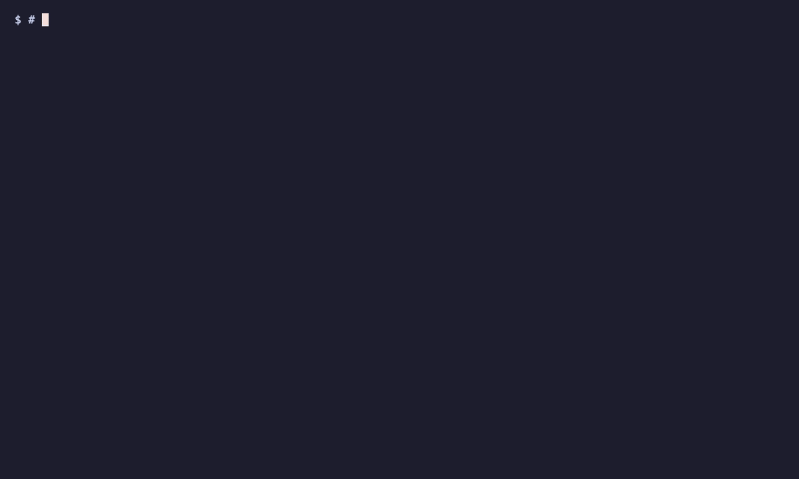
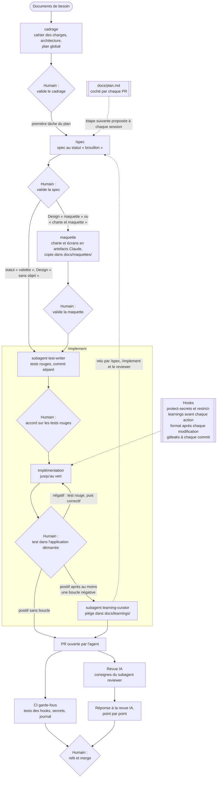

# agentic-dev-workflow

Template de développement agentique pour les développeurs qui confient du code à Claude Code : du cadrage du besoin à la PR mergée, en passant par la spec validée, avec des garde-fous locaux, une CI et une revue IA de chaque PR. L'agent conduit la chaîne et propose chaque étape ; l'humain valide, sans commande à taper.

**Statut : en construction, pas encore éprouvé sur un projet réel. Il le sera d'abord sur le projet FieldOps.**
Version de Claude Code testée : **2.1.291**, le 2026-10-08.



*Démonstration générée par [vhs](https://github.com/charmbracelet/vhs) (facultatif, sert uniquement à la régénérer) à partir de [`docs/demo/demo.tape`](docs/demo/demo.tape) : `vhs docs/demo/demo.tape` depuis la racine. À régénérer si l'affichage de `init.sh` ou des hooks change.*

## Le flux, du cadrage au merge

Les losanges sont les points de contrôle humains ([ADR-002](docs/adr/002-place-revue-humaine.md)) ; tout le reste est fait par l'agent ou par la CI. À chaque début de session, l'agent annonce la première tâche non cochée du plan et lance l'étape après l'accord de l'humain ([spec 008](docs/specs/008-cadrage-et-plan-global.md)).



Chaque étape et le fichier qui la porte :

| Étape | Fichier |
| --- | --- |
| Cadrage | [`.claude/skills/cadrage/SKILL.md`](.claude/skills/cadrage/SKILL.md), imposé par la règle « Cadrage et étape suivante » de [`CLAUDE.md`](CLAUDE.md) et signalé par [`session-start.sh`](.claude/hooks/session-start.sh) ; [spec 008](docs/specs/008-cadrage-et-plan-global.md) |
| Plan global | `docs/plan.md`, modèle [`docs/templates/plan.md`](docs/templates/plan.md), coché par la PR qui fait le travail |
| `/spec` | [`.claude/skills/spec/SKILL.md`](.claude/skills/spec/SKILL.md), modèle [`docs/templates/spec.md`](docs/templates/spec.md) |
| Validation humaine de la spec | statut « validée » exigé par l'étape 1 de `/implement` ; [ADR-002](docs/adr/002-place-revue-humaine.md) |
| Maquette | [`.claude/skills/maquette/SKILL.md`](.claude/skills/maquette/SKILL.md), demandée par la ligne « Design » de la spec et contrôlée par l'étape 1 de `/implement` ; [spec 009](docs/specs/009-design-system-et-maquette.md) |
| `test-writer` | [`.claude/agents/test-writer.md`](.claude/agents/test-writer.md), appelé par l'étape 4 de `/implement` ; [ADR-003](docs/adr/003-strategie-test-first.md) |
| `/implement` | [`.claude/skills/implement/SKILL.md`](.claude/skills/implement/SKILL.md) |
| Hooks | [`.claude/hooks/protect-secrets.sh`](.claude/hooks/protect-secrets.sh), [`.claude/hooks/restrict-learnings.sh`](.claude/hooks/restrict-learnings.sh), [`.claude/hooks/format.sh`](.claude/hooks/format.sh), branchés dans [`.claude/settings.json`](.claude/settings.json) ; [`.githooks/pre-commit`](.githooks/pre-commit) |
| Test humain | étape 8 de `/implement` ; [spec 005](docs/specs/005-capitalisation-des-pieges.md) |
| `learning-curator` | [`.claude/agents/learning-curator.md`](.claude/agents/learning-curator.md), appelé par l'étape 9 de `/implement` |
| CI | [`.github/workflows/garde-fous.yml`](.github/workflows/garde-fous.yml) |
| `reviewer` et revue IA | [`.claude/agents/reviewer.md`](.claude/agents/reviewer.md), en local par [`/review`](.claude/skills/review/SKILL.md) et sur chaque PR par [`.github/workflows/ai-review.yml`](.github/workflows/ai-review.yml), contrôlé par [`verifier-revue-ia.sh`](.github/scripts/verifier-revue-ia.sh) |
| Réponse à la revue IA | règle n°5 de [`CLAUDE.md`](CLAUDE.md) |
| Merge humain | règle de travail ([ADR-002](docs/adr/002-place-revue-humaine.md)) et ruleset de `main` (voir [Configuration GitHub](#configuration-github)) |

Le schéma omet deux étapes de `/implement` sans décision humaine : la création de la branche et de son journal (étape 2), et la mise à jour des documents de référence (étape 10). À chaque commit, l'agent complète aussi le journal de sa branche (`docs/journal/`), qui permet de reprendre une session interrompue ([spec 004](docs/specs/004-reprise-de-session.md)).

## Prérequis

| Outil | Rôle | Sans lui |
| --- | --- | --- |
| [Claude Code](https://claude.com/claude-code) | l'agent de code | — |
| [jq](https://jqlang.org) | lu par les hooks de Claude Code | les hooks refusent **toutes** les actions surveillées (Read, Edit, Write, Bash) |
| [gitleaks](https://github.com/gitleaks/gitleaks), même version que la CI (`GITLEAKS_VERSION` dans `garde-fous.yml`) | détection de secrets avant chaque commit | le hook pre-commit refuse **tous** les commits |
| [shellcheck](https://www.shellcheck.net) | vérification des scripts shell | seule la CI les vérifie |
| [gh](https://cli.github.com) | GitHub en ligne de commande | configuration GitHub à faire dans l'interface web |

La CI installe elle-même gitleaks en version fixée, et vérifie l'archive avec le fichier d'empreintes publié avec la release. Sur ce template, Renovate propose les nouvelles versions par PR (`renovate.json`).

## Installation

### Nouveau projet

1. Sur GitHub, cliquer sur **« Use this template »** pour créer le dépôt, puis le cloner.
2. Supprimer les fichiers propres au template :

   ```bash
   git rm docs/adr/001-authentification-ci.md docs/specs/001-script-init.md \
     docs/specs/002-hook-protect-secrets.md docs/specs/003-documents-de-reference.md \
     docs/specs/004-reprise-de-session.md docs/specs/005-capitalisation-des-pieges.md \
     docs/specs/006-revue-securite-et-hooks-qualite.md docs/specs/007-modele-par-agent.md \
     docs/specs/008-cadrage-et-plan-global.md docs/specs/009-design-system-et-maquette.md \
     scripts/init.sh scripts/lint-shell.sh \
     tests/init-script.sh tests/lint-shell.sh .github/workflows/template-ci.yml
   ```

   Puis vider les commandes de lint et de tests du template, à remplacer par celles du projet :

   ```bash
   printf '{\n  "lint": "",\n  "test": ""\n}\n' > .claude/quality.json
   ```

3. Vider le journal du template (un fichier par branche, créé par l'agent au premier commit) :

   ```bash
   git rm -q 'docs/journal/*.md' && touch docs/journal/.gitkeep && git add docs/journal/.gitkeep
   ```

4. Créer les documents de référence et le plan à partir de leurs modèles. À la première session, l'agent propose de les remplir par le cadrage, à partir des documents de besoin que vous lui donnez :

   ```bash
   cp docs/templates/cahier-des-charges-fonctionnel.md docs/templates/architecture-technique.md docs/templates/plan.md docs/
   ```

5. Activer le hook pre-commit (une fois par clone) :

   ```bash
   git config core.hooksPath .githooks
   ```

6. Remplacer ce `README.md` par celui du projet, en gardant si besoin un lien vers le template :

   ```bash
   printf '# <nom du projet>\n\nInitialisé avec https://github.com/yanis-vroland/agentic-dev-workflow\n' > README.md
   ```

7. Committer ce nettoyage, puis passer à la [configuration GitHub](#configuration-github), à suivre depuis le README du template.

### Projet existant

Cloner ce template n'importe où, puis lancer le script depuis ce clone :

```bash
git clone https://github.com/yanis-vroland/agentic-dev-workflow.git
agentic-dev-workflow/scripts/init.sh <chemin-du-projet> [--force]
```

Le script :

- copie les garde-fous, les skills, les workflows génériques, le modèle de PR et `CLAUDE.md` ;
- n'écrase aucun fichier existant sans `--force`, et liste ceux qu'il a ignorés ;
- crée `docs/adr/`, `docs/specs/`, `docs/journal/`, `docs/learnings/`, les deux documents de référence (cahier des charges fonctionnel, architecture technique) et le plan (`docs/plan.md`), sans jamais écraser un fichier existant, même avec `--force` ; si un `docs/journal.md` existe déjà, il propose la commande `git mv` pour le migrer ;
- crée `.claude/quality.json` avec des commandes de lint et de tests vides, sans jamais remplacer un fichier existant, même avec `--force` ;
- complète le `.gitignore` (`.env`, `.env.*`, `!.env.example`, `.claude/settings.local.json`) ;
- active `core.hooksPath` ;
- affiche à la fin les étapes manuelles restantes.

Il refuse de cibler un sous-dossier d'un dépôt Git : il faut viser la racine. Comportement détaillé : [`docs/specs/001-script-init.md`](docs/specs/001-script-init.md).

Si le projet a déjà un `.claude/settings.json`, le script ne l'écrase pas, et **les garde-fous ne sont alors pas installés** : il faut fusionner à la main les permissions et les hooks du template.

### Dans les deux cas

Compléter les sections **« À ADAPTER »** de `CLAUDE.md` : description du projet, commandes, architecture.

Déclarer dans `.claude/quality.json` les commandes que les hooks lancent ([spec 006](docs/specs/006-revue-securite-et-hooks-qualite.md)) :

```json
{
  "lint": "pnpm exec eslint",
  "test": "pnpm test"
}
```

`lint` reçoit le chemin absolu du fichier modifié en dernier argument, et doit ignorer les fichiers qu'il ne sait pas traiter. `test` est lancé sans argument depuis la racine. Une clé vide désactive le hook correspondant.

## Configuration GitHub

1. **Application GitHub Claude** : dans Claude Code, lancer `/install-github-app` et suivre les étapes.
2. **Secret `CLAUDE_CODE_OAUTH_TOKEN`** : générer un jeton avec `claude setup-token`. L'ajouter ensuite au dépôt, dans *Settings > Secrets and variables > Actions*, ou avec `gh secret set CLAUDE_CODE_OAUTH_TOKEN`. La revue IA s'authentifie avec ce jeton ; le choix d'un jeton d'abonnement plutôt que d'une clé API est expliqué dans l'[ADR-001](docs/adr/001-authentification-ci.md).
3. **Ruleset sur `main`** (*Settings > Rules > Rulesets*) :
   - PR obligatoire ;
   - suppression et force-push interdits ;
   - vérifications requises : « Tests des garde-fous », « Détection de secrets » et « Journal ». Sur ce template, s'y ajoute « Vérifications du template ».
4. **Label `agent-corrigé`**, qui marque les PR où du code de l'agent a été refusé ou corrigé :

   ```bash
   gh label create agent-corrigé --color D93F0B --description "Code de l'agent refusé ou corrigé par l'humain"
   ```

## Garde-fous

- **Hook `protect-secrets.sh`** (Claude Code) : refuse à l'agent l'accès aux fichiers `.env` et `.env.*`, sauf `.env.example`. Une simple mention dans un message de commit ou un corps de PR reste permise. En cas de doute (commande non analysable, erreur interne, jq absent), il refuse. Comportement détaillé : [`docs/specs/002-hook-protect-secrets.md`](docs/specs/002-hook-protect-secrets.md).
- **Hook `pre-commit`** (Git) : gitleaks analyse les fichiers indexés et refuse le commit si un secret est détecté. Il se contourne avec `git commit --no-verify` : le vrai filet de sécurité est le job CI « Détection de secrets », qui analyse tout l'historique.
- **Revue IA** : chaque PR ouverte est relue selon `.claude/agents/reviewer.md`, et le rapport est publié en commentaire. Le job échoue si la revue n'a pas tourné ou si des actions ont été refusées pendant la revue. Une PR qui modifie `ai-review.yml` ne peut pas être relue par l'IA (protection de `claude-code-action`) : son job « Revue IA » est rouge, et elle se relit à la main.
- **Journal sans conflit** : un fichier de journal par branche (`docs/journal/`), jamais modifié après son merge. Le job CI « Journal » refuse une PR qui touche un journal déjà mergé, ou dont les noms et les dates sont invalides. Deux PR ne peuvent donc pas entrer en conflit sur le journal. Comportement détaillé : [`docs/specs/004-reprise-de-session.md`](docs/specs/004-reprise-de-session.md).
- **Test humain et pièges** : `/implement` ne termine qu'après un test humain positif dans l'application démarrée. Chaque retour négatif ajoute un test qui échoue, puis un correctif, puis un nouveau test humain. Après au moins une boucle négative, le subagent `learning-curator` capitalise le piège dans `docs/learnings/` (un fichier par piège, seulement s'il se généralise) ; le hook `restrict-learnings.sh` lui refuse toute écriture ailleurs. Une PR sans changement de comportement observable indique le test humain « sans objet ». `/spec`, `/implement` et le reviewer relisent les pièges actifs au cadrage suivant. Comportement détaillé : [`docs/specs/005-capitalisation-des-pieges.md`](docs/specs/005-capitalisation-des-pieges.md).
- **Lint et tests** : après chaque modification de l'agent, le hook `lint.sh` formate le fichier (`format.sh`), puis lance le lint déclaré dans `.claude/quality.json` ; un échec est renvoyé à l'agent, qui corrige. À la fin de chaque tour où un fichier a été modifié, `run-tests.sh` lance les tests ; un échec est renvoyé une fois à l'agent, puis signalé à l'humain sans bloquer, pour ne pas pousser l'agent à modifier des tests rouges attendus en phase test-first. Comportement détaillé : [`docs/specs/006-revue-securite-et-hooks-qualite.md`](docs/specs/006-revue-securite-et-hooks-qualite.md).
- **Revue de sécurité** : avant le test humain, `/implement` transmet le diff au subagent `security-reviewer`, qui le relit selon l'OWASP Top 10 2025. Il n'a que `Read`, `Grep` et `Glob` : il ne peut rien exécuter ni modifier, ce que la CI du template vérifie.
- **Modèle par subagent** : chaque subagent déclare son modèle selon la nature de sa tâche ([ADR-005](docs/adr/005-choix-du-modele-par-agent.md)) : `opus` pour juger (`reviewer`, `security-reviewer`), `sonnet` pour exécuter une tâche cadrée (`test-writer`, `learning-curator`). Le job « Garde-fous » refuse un subagent sans modèle, avec `inherit` ou hors de la liste ; la revue IA en CI lit le modèle dans `reviewer.md`. Si un modèle est indisponible, l'agent demande à l'humain quel substitut utiliser. Comportement détaillé : [`docs/specs/007-modele-par-agent.md`](docs/specs/007-modele-par-agent.md).
- **Début de session** : le hook `session-start.sh` récupère `origin` et avance la branche seulement si l'arbre est propre et qu'aucune divergence n'existe. Il ne rebase et ne fusionne jamais. Il signale aussi l'état du cadrage : « Cadrage à faire » tant que le cahier des charges contient « À ADAPTER », « Plan absent », ou la première tâche non cochée du plan. Le blocage avant cadrage est une règle de `CLAUDE.md`, pas une protection technique : aucun hook ne refuse l'écriture de code ([spec 008](docs/specs/008-cadrage-et-plan-global.md)).

## Comment ce projet a été construit

Le template a été construit avec sa propre chaîne, du 7 au 13 octobre 2026 : 30 PR ouvertes par l'agent, relues et mergées par l'humain (#1 à #40, numérotation partagée avec les issues). Les sources sont les PR, leurs commentaires et le journal de chaque branche (`docs/journal/`).

**Specs et décisions**

| Document | PR |
| --- | --- |
| [Spec 001](docs/specs/001-script-init.md), script d'initialisation | #8, puis #28 (issue #27 : copie de fichiers non suivis) |
| [Spec 002](docs/specs/002-hook-protect-secrets.md), hook `protect-secrets` | #11 (issue #7 : fermeture en cas de panne), #12 (issue #9 : faux positifs) |
| [Spec 003](docs/specs/003-documents-de-reference.md), documents de référence | #31, puis #33 (lignes perdues à la résolution d'un conflit) |
| [Spec 004](docs/specs/004-reprise-de-session.md), reprise de session | #32, complétée par #33 |
| [Spec 005](docs/specs/005-capitalisation-des-pieges.md), test humain et pièges | #35, complétée par #42 (revue IA de la PR #18 de FieldOps : hook `restrict-learnings`) |
| [Spec 006](docs/specs/006-revue-securite-et-hooks-qualite.md), revue de sécurité et hooks de lint et de tests | #37, puis #38 (rattrapage de la revue de sécurité) |
| [Spec 007](docs/specs/007-modele-par-agent.md) et [ADR-005](docs/adr/005-choix-du-modele-par-agent.md), modèle par subagent | #39 |
| [Spec 008](docs/specs/008-cadrage-et-plan-global.md), cadrage et plan global conduits par l'agent (frictions de Tidemark) | #44 (spec et tests), #46 (implémentation), #50 et #51 (suites) |
| [Spec 009](docs/specs/009-design-system-et-maquette.md), design system et maquette avant les tests (frictions de Tidemark) | #45 (spec), #52 (implémentation) |
| [ADR-001](docs/adr/001-authentification-ci.md) à [ADR-003](docs/adr/003-strategie-test-first.md) | ADR-001 dans #1 ; ADR-002 et ADR-003 dans #21, tirés des constats des PR #4 à #13 |
| [ADR-004](docs/adr/004-choix-outil-agent.md), outil d'agent (proposé) | #36 |

**Ce que la revue IA a trouvé**

- **#4 :** un test du hook pre-commit passait aussi avec un hook qui refuse tout. Corrigé, et vérifié par mutation. Dans la même revue, un point sur des versions de gitleaks désalignées a été jugé non fondé, logs du job à l'appui.
- **#28 :** deux cas limites de `init.sh` (template dans un sous-dossier d'un autre dépôt, fichier suivi mais supprimé du disque). La spec a été complétée, et les tests ont été rouges avant la correction.
- **#32 :** trois points bloquants sur la spec 004 avant la moindre ligne de code, dont une migration de l'ancien journal que la CI aurait refusée.

Depuis la #4, l'agent répond point par point dans un commentaire « Réponse à la revue IA » : corrigé, non suivi et pourquoi, ou reporté. C'est devenu la règle n°5 de `CLAUDE.md` (#30).

**Ce que la revue IA n'a pas vu**

- **#8 :** aucun rapport publié, job vert. Le hook `protect-secrets` refusait la publication d'un rapport qui citait des fichiers `.env`. Corrigé par #10 (rapport publié depuis un fichier).
- **#10 et #12 :** l'action ne s'exécute pas quand une PR modifie son propre workflow, et le job restait vert. Depuis #12, `verifier-revue-ia.sh` le fait échouer.
- Les commits de correction poussés après l'ouverture ne sont pas relus (voir [Limites](#limites)).

**Ce que l'humain a décidé**

Les décisions qui ont le plus changé le résultat sont venues de l'humain ([ADR-002](docs/adr/002-place-revue-humaine.md)) : la règle de spec fondée sur la nature du changement plutôt que sur le préfixe (#6), la fermeture en cas de panne de `protect-secrets` (#11), le parcours d'installation du README (#13), les exemples de pièges de la spec 005 tirés de FieldOps (#35).

Le contrôle par mutation a trouvé des trous que ni les tests ni la relecture n'avaient vus : une insertion désactivée dans le `.gitignore` (#8), un `grep` manquant qui laissait passer l'action (#11), un compteur non numérique accepté (#12) ([ADR-003](docs/adr/003-strategie-test-first.md)).

**Écarts au processus** (constatés au 2026-10-13)

- Le label `agent-corrigé` n'a été posé sur aucune PR, alors que l'humain a corrigé le travail de l'agent sur plusieurs d'entre elles : il ne mesure encore rien.
- Les PR #31 à #35 n'ont pas de commentaire « Réponse à la revue IA ».
- Les tests de la spec 005 ont été écrits par l'agent principal, pas par `test-writer` : la session, lancée depuis un dossier parent, ne chargeait pas les subagents du dépôt (journal de la branche).
- Le test humain de la spec 007 a été joué par l'agent, dans de vraies sessions Claude Code, et accepté par l'humain : une exception à la spec 005, consignée dans le journal de #41.
- Deux PR ont été mergées avant leur étape de clôture : #39 avant le push de son dernier commit, rattrapé par #40 ; #40 avant la réponse à sa revue IA, rattrapée par #41.

**Exemple FieldOps à venir (#15)**

*Emplacement réservé : un exemple réel de code de l'agent refusé ou corrigé sur FieldOps, avec le piège capitalisé qui en résulte (CA12 de la spec 005).*

## Limites

Constatées pendant la construction du template ; elles restent vraies aujourd'hui.

**Revue IA**
- **PR qui modifie `ai-review.yml` :** `claude-code-action` ne s'exécute pas quand le workflow de la PR diffère de celui de `main`. Le job « Revue IA » est rouge et la PR se relit à la main.
- **Commits de correction :** la revue ne tourne qu'à l'ouverture de la PR (`opened`, `reopened`, `ready_for_review`). Les commits poussés ensuite ne sont pas relus par l'IA. Contournement : relecture humaine des corrections.
- **Compteur de refus :** `permission_denials_count` compte tous les refus pendant la revue, pas seulement ceux du hook. Une tentative de lancer une commande non autorisée, comme les tests, fait échouer le job. Le prompt rappelle les seules commandes permises.
- **Format du fichier de résultat :** il n'est pas documenté. `verifier-revue-ia.sh` accepte deux formes et échoue sur un format inattendu, plutôt que de passer en silence.

**Secrets**
- **`--no-verify` :** le hook pre-commit se contourne avec `git commit --no-verify`. Le job CI « Détection de secrets » reste le filet de sécurité.
- **Accès indirects :** `protect-secrets.sh` ne détecte pas un accès aux `.env` sans mention littérale, par une variable (`f=.env; cat "$f"`), un motif (`cat .e*`) ou un lien symbolique.
- **Refus par prudence :** certaines commandes légitimes sont refusées quand elles citent `.env` : un heredoc ou un `$(…)`, `git commit -am`, ou `sudo` et `env` devant `git` ou `gh`. Contournement : `git commit -F <fichier>` et `gh … --body-file <fichier>`.
- La référence pour ces cas est la [spec 002](docs/specs/002-hook-protect-secrets.md) (règles et section « Hors périmètre »), vérifiée par `tests/hooks.sh`.
- **Version de gitleaks :** sur ce template, Renovate propose la mise à jour de `GITLEAKS_VERSION` dans `garde-fous.yml`. La version installée en local se met à jour à la main (`brew upgrade gitleaks`). Dans un projet initialisé, `renovate.json` n'est pas copié : la mise à jour y reste manuelle. L'empreinte de l'archive vient du fichier publié avec la release : elle protège d'un téléchargement corrompu, pas d'une release compromise.

**Processus**
- **Reprise de session :** une session fermée sans prévenir perd le travail non committé, car l'agent ne peut pas agir à la fermeture (spec 004). La mémoire locale est désactivée par `.claude/settings.json`, mais un réglage personnel (`.claude/settings.local.json`) peut la réactiver.
- **Test humain et pièges :** le test humain et la capitalisation sont des règles de travail (`/implement`, `CLAUDE.md`), pas des vérifications de CI : rien n'empêche techniquement de les sauter, seul le reviewer le signale. `learning-curator` n'écrit que dans `docs/learnings/<slug>.md` : le hook `restrict-learnings.sh` le vérifie grâce au champ `agent_type` que Claude Code transmet aux hooks. Un hook déclaré dans l'en-tête d'un subagent (champ `hooks:`) n'est pas exécuté par Claude Code 2.1.291 : le premier essai, testé en vrai, laissait passer une écriture dans `README.md` (journal de la branche `fix/spec-005-revue-fieldops-18`). Cette protection dépend du champ `agent_type` et du nom du subagent : la CI vérifie le nom, pas le champ, et elle disparaîtrait sans alerte si Claude Code cessait de le transmettre. Le hook tourne sur chaque appel d'outil de toute session, revue IA en CI comprise, et sans `jq` il refuse tout, au-delà de ce que bloque déjà `protect-secrets.sh`.
- **Commandes de `.claude/quality.json` :** ce sont des commandes shell exécutées automatiquement sur le poste de quiconque utilise Claude Code dans le projet, comme celles de `.claude/settings.json`. Une PR qui modifie ce fichier se relit en entier ([ADR-002](docs/adr/002-place-revue-humaine.md)). Pendant une session, autoriser l'agent à modifier un fichier revient désormais à l'autoriser à exécuter du code sans demande : `lint.sh` et `run-tests.sh` lancent aussitôt `quality.json`, la configuration du lint, les tests ou les hooks que l'agent vient d'écrire. Un test qui affiche un secret le renvoie à l'agent sans passer par `protect-secrets`. Les sorties du lint et des tests sont transmises comme des données, mais un agent manipulé par un contenu qu'il a lu reste le risque principal.
- **Lint et tests :** les tests ne tournent qu'à la fin d'un tour, pas après chaque modification ; leur durée s'ajoute à chaque tour qui modifie un fichier, documentation comprise. Un hook qui dépasse sa durée maximale (60 s pour le lint, 300 s pour les tests) est interrompu par Claude Code.
- **Revue de sécurité :** elle n'est appelée que par `/implement`, pas par la revue IA en CI. Une PR faite sans `/implement` n'a que la rubrique « Sécurité » du reviewer.
- **Modèle des subagents :** la CI vérifie qu'un modèle autorisé est déclaré, pas qu'il est le bon : la justification se relit dans la PR. Un paramètre `model` passé à l'invocation l'emporte sur l'en-tête ; ne le passer que pour un substitut choisi par l'humain est une règle de travail, pas une protection. Les alias suivent la dernière version des modèles : le comportement d'un subagent peut changer sans changement dans le dépôt. Aucun coût par modèle n'a été mesuré.
- **Merge :** « seul l'humain merge » ([ADR-002](docs/adr/002-place-revue-humaine.md)) est une règle de travail, pas une protection technique. Le ruleset impose une PR et des vérifications vertes, mais un agent qui dispose des droits de l'humain via `gh` pourrait merger.

## Structure

| Élément | Rôle |
| --- | --- |
| `CLAUDE.md` | règles de travail de l'agent : langue, spec avant code, test-first, définition du « done », interdits |
| `.claude/settings.json` | permissions refusées à l'agent et branchement des hooks |
| `.claude/hooks/protect-secrets.sh` | refus des accès aux fichiers `.env` |
| `.claude/hooks/restrict-learnings.sh` | avant chaque action de `learning-curator` : écriture limitée à `docs/learnings/<slug>.md`, pas d'autre outil que `Read`, `Grep`, `Glob`, `Write` et `Edit` |
| `.claude/hooks/format.sh` | formatage par Prettier, s'il est installé dans le projet ; appelé par `lint.sh` |
| `.claude/hooks/lint.sh` | après chaque modification : formatage, puis lint déclaré dans `.claude/quality.json` |
| `.claude/hooks/run-tests.sh` | à la fin de chaque tour où un fichier a été modifié : tests déclarés dans `.claude/quality.json` |
| `.claude/hooks/quality-common.sh` | fonctions partagées par `lint.sh` et `run-tests.sh` |
| `.claude/quality.json` | commandes de lint et de tests du projet (sur ce template : shellcheck et `tests/hooks.sh`) |
| `.claude/hooks/session-start.sh` | au début de chaque session : récupération, mise à jour sans risque, état de la branche, dernière entrée de journal, PR ouvertes |
| `.claude/skills/spec/` | `/spec` : rédiger une spec à partir d'un besoin |
| `.claude/skills/implement/` | `/implement` : implémenter une spec validée en test-first |
| `.claude/skills/review/` | `/review` : relire la branche avant la PR |
| `.claude/agents/reviewer.md` | subagent de revue, utilisé aussi par la revue IA en CI ; modèle `opus` |
| `.claude/agents/test-writer.md` | subagent qui écrit les tests à partir des critères d'acceptation ; modèle `sonnet` |
| `.claude/agents/learning-curator.md` | subagent qui capitalise un piège découvert au test humain, sans `Bash`, écritures limitées par `restrict-learnings.sh` ; modèle `sonnet` |
| `.claude/agents/security-reviewer.md` | subagent de revue de sécurité du diff (OWASP Top 10 2025), en lecture seule ; modèle `opus` |
| `.githooks/pre-commit` | détection de secrets avant chaque commit |
| `.github/workflows/garde-fous.yml` | CI générique : tests des hooks, test du pre-commit, détection de secrets, contrôle du journal |
| `.github/workflows/ai-review.yml` | revue IA de chaque PR |
| `.github/workflows/template-ci.yml` | CI propre au template, non copiée par `init.sh` |
| `.github/scripts/verifier-revue-ia.sh` | fait échouer la revue IA si elle n'a pas tourné ou a subi des refus |
| `.github/scripts/verifier-modeles.sh` | refuse un subagent sans modèle autorisé, et donne à la revue IA le modèle de `reviewer.md` |
| `.github/scripts/verifier-journal.sh` | refuse une PR qui modifie un journal déjà mergé, ou dont les noms et dates du journal sont invalides |
| `.github/pull_request_template.md` | modèle de PR : spec liée, critères couverts, vérifications humaines, corrections |
| `docs/templates/spec.md` | modèle de spec |
| `docs/templates/cahier-des-charges-fonctionnel.md` | modèle du cahier des charges : acteurs, glossaire, règles métier, parcours, fonctionnalités |
| `docs/templates/architecture-technique.md` | modèle de l'architecture technique : données, contrats, sécurité, infrastructure, index des ADR |
| `docs/specs/` | specs du projet |
| `docs/adr/` | décisions d'architecture |
| `docs/journal/` | journal de bord, un fichier par branche, entrées datées : fait, décisions, corrections et limites, prochaine étape ; sert à reprendre une session |
| `docs/learnings/` | pièges découverts au test humain, un fichier par piège : symptôme, cause racine, règle pour la prochaine fois ; relus au cadrage |
| `docs/guide-adoption.md` | introduire le template dans une équipe : rôles, rituels, démarrage progressif |
| `scripts/init.sh` | application du template à un projet existant |
| `scripts/lint-shell.sh` | lint du template : shellcheck sur les fichiers shell (non copié par `init.sh`) |
| `renovate.json` | mises à jour proposées par Renovate : gitleaks et `claude-code-action` (non copié par `init.sh`) |
| `tests/` | tests des hooks, du pre-commit, de la vérification de la revue, de `init.sh` et du lint du template |

## Licence

MIT, voir [LICENSE](LICENSE).
