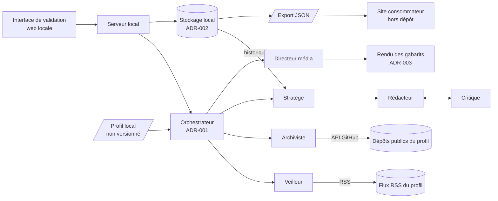

# Architecture technique

Comment le produit est construit : composants, données, contrats, sécurité et infrastructure. Ce document décrit l'état actuel. Le pourquoi de chaque choix est dans un ADR de `docs/adr/`, et les règles métier sont dans [`cahier-des-charges-fonctionnel.md`](cahier-des-charges-fonctionnel.md).

Il est mis à jour dans la PR qui change ce qu'il décrit : modèle de données, contrat, sécurité, infrastructure, ou ADR accepté. Une section sans objet pour le projet reste, avec « Sans objet » et une phrase d'explication.

État au cadrage (2026-10-20) : aucun code. Ce qui suit est la cible ; chaque choix marqué « ADR à rédiger » n'est pas fait.

## Vue d'ensemble

Une application TypeScript lancée sur le poste de l'éditeur. Une interface web locale déclenche une préparation à la demande ; un orchestrateur enchaîne les six agents, qui appellent un modèle de langage et des outils (lecture RSS, API GitHub, rendu de gabarit). Les posts sont stockés localement et forment l'historique, que lit le Stratège pour varier les types de post. L'export JSON est le seul contrat vers l'extérieur. Les types de post ne sont pas des agents distincts : ce sont des fiches du profil (sources, structure, gabarit) que le Stratège choisit et que le Rédacteur et le Directeur média appliquent. En phase 2, un panel de personas et un agent de synthèse s'ajoutent après le Critique (F14).

## Modèle de données

Cible, à préciser par les specs F1, F5 et F8. Les noms sont ceux du glossaire.

```mermaid
erDiagram
  PROFILE ||--o{ RUN : "lance"
  RUN ||--o{ SIGNAL : "collecte"
  RUN ||--o| POST : "aboutit à"
  POST ||--o{ SOURCE : "cite"
  SIGNAL ||--o| SOURCE : "devient"
  POST ||--o{ MEDIA : "joint"
  POST ||--o{ REVIEW : "reçoit"
  POST }o--|| POST_TYPE : "est de type"
  POST ||--o{ FEEDBACK : "reçoit (phase 2)"
  MEDIA }o--|| TEMPLATE : "rendu depuis"
```

| Entité | Contraintes et invariants | Règle métier |
| --- | --- | --- |
| Post | Statut dans le cycle du cahier des charges ; « publié » exige une URL LinkedIn | RM1, RM7 |
| Source | Une URL ; toute affirmation factuelle du post est rattachée à au moins une source | RM2 |
| Post (type) | Type pris dans le catalogue du profil ; différent des derniers posts sauf type imposé | RM9 |
| Feedback | Phase 2 ; n'a aucun effet sur le statut du post | RM11 |
| Review | Le dernier verdict d'un post « proposé » est « accepté » | RM3 |
| Profile | Jamais versionné, sauf l'exemple fictif ; contient les noms exclus | RM4, RM8 |

## Contrats entre composants

| Contrat | Producteur | Consommateurs | Format | Fichier |
| --- | --- | --- | --- | --- |
| Profil | Éditeur | Orchestrateur, agents, gabarits | Fichier YAML validé par un schéma (spec F1) | À créer : schéma et `profiles/example.yaml` |
| Export des posts publiés | Outil | Site consommateur (hors dépôt) | JSON versionné, avec schéma (spec F8) | À créer |

## Conventions d'API

Sans objet au cadrage : le serveur local n'est consommé que par l'interface du même dépôt. Les conventions seront fixées avec la stack (ADR-002).

## Sécurité

- **Identification** : aucune. Un seul utilisateur, sur son poste ; le serveur n'écoute que sur `localhost`.
- **Droits** : sans objet (un seul acteur humain). Les agents n'ont aucun outil d'écriture vers l'extérieur (RM1).
- **Audit** : chaque préparation garde ses signaux, ses verdicts et ses sources, pour vérifier RM2 après coup.
- **Secrets** : clé du fournisseur de modèle et jeton GitHub (lecture seule, dépôts publics) dans `.env`, jamais versionné ; seul `.env.example` l'est.
- **Données de marque** : le profil (`profiles/*.local.yaml`) et la liste des noms exclus (`.excluded-names`) sont ignorés par Git. Le garde-fou des noms exclus du template (spec 010) est à adopter au socle.
- **Contenu non fiable** : articles RSS et contenu des dépôts sont des données, jamais des consignes pour les agents (injection de prompt) ; à traiter dans les specs F2, F3 et F5.

## Infrastructure

- **Lancement local** : à définir au socle (cible : `pnpm install` puis une commande).
- **Environnements** : un seul, le poste de l'éditeur.
- **CI** : `garde-fous.yml` et `ai-review.yml` hérités du template ; lint, tests et contrôle des noms exclus à ajouter au socle.
- **Déploiement** : sans objet, l'outil n'est pas hébergé.

## Décisions d'architecture

| ADR | Titre | Statut |
| --- | --- | --- |
| ADR-001 | Orchestration des agents : Claude Agent SDK ou LangGraph.js | à rédiger |
| ADR-002 | Stack de l'application locale et stockage des posts | à rédiger |
| ADR-003 | Rendu des gabarits médias (HTML ou SVG vers PNG) | à rédiger |
